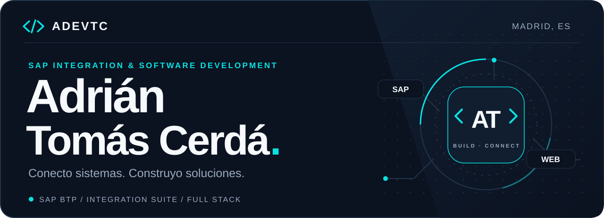
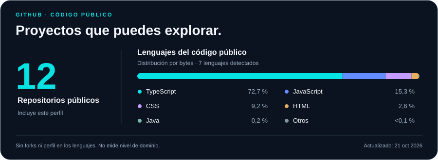
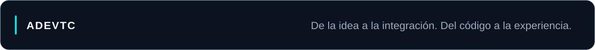

  <picture>
    <source media="(max-width: 640px) and (prefers-color-scheme: dark)" srcset="./assets/header-mobile-dark.svg" />
    <source media="(max-width: 640px) and (prefers-color-scheme: light)" srcset="./assets/header-mobile-light.svg" />
    <source media="(prefers-color-scheme: dark)" srcset="./assets/header-dark.svg" />
    <source media="(prefers-color-scheme: light)" srcset="./assets/header-light.svg" />
    
  </picture>

  <h1>Hola, soy Adrián 👋</h1>
  <h3>SAP BTP &amp; Cloud Integration · Full Stack Developer</h3>

  

    <strong>Responsable de BTP &amp; Integraciones en Alsea</strong> 
    Madrid, España · Ingeniería Informática en UNIR, en curso
  

  

    
    
    
  

  

    <a href="#sobre-mí">Sobre mí</a> ·
    <a href="#proyectos-destacados">Proyectos</a> ·
    <a href="#stack-técnico">Stack</a> ·
    <a href="#experiencia">Experiencia</a> ·
    <a href="#contacto">Contacto</a>
  

---

## Sobre mí

Me gusta entender cómo encajan las piezas: **el proceso de negocio, los sistemas que lo sostienen y la persona que acaba utilizándolo**. Trabajo conectando aplicaciones empresariales con SAP y desarrollo productos web en los que cuido tanto la lógica como la experiencia de uso.

Mi especialidad es **SAP BTP e Integration Suite**: iFlows, Groovy, APIs, transformaciones y gestión de errores. También he trabajado con **SAP CAP, Node.js y CDS**, y disfruto construyendo aplicaciones con **TypeScript, React, Next.js y Java**.

- **Ahora, en Alsea:** BTP e integraciones entre sistemas, seguimiento de interfaces y resolución de incidencias.
- **Experiencia aplicada:** interoperabilidad clínica con HL7, procesos de RR. HH. con SuccessFactors y SAP ECP, e integraciones financieras.
- **Fuera del entorno corporativo:** convierto ideas propias en aplicaciones de fútbol, comunidades y herramientas web.
- **Mi forma de trabajar:** entender el problema, desarrollar una solución clara y poder seguir lo que ocurre cuando llega a producción.

> Una integración útil conecta procesos. Una buena aplicación hace que usarlos resulte sencillo.

## Proyectos destacados

### ⚽ Manchester Piti

**Una plataforma para gestionar y seguir la vida de un equipo de fútbol 7.** Resultados, histórico, estadísticas y rankings, con un vestuario privado para disponibilidad, votaciones de MVP, actas y pizarra táctica.

`React` `TypeScript` `Firebase` `Tailwind CSS` `Vite`

**[Abrir Manchester Piti ↗](https://manchester-piti.vercel.app)** · [Explorar el código](https://github.com/AdevTC/Manchester-Piti)

### 🏆 Fantasya

**Ligas fantasy y comunidades privadas en una misma aplicación.** Gestión de temporadas, roles y funciones sociales para organizar la competición y mantener conectado al grupo.

`React` `Firebase` `Tailwind CSS` `Vite`

**[Abrir Fantasya ↗](https://fantasya-app.vercel.app)** · [Explorar el código](https://github.com/AdevTC/fantasya-app)

### 🌍 World Cup 2026 Simulator

**Una herramienta para explorar cómo podría desarrollarse un Mundial.** Simulación de sorteos y fases de competición mediante una interfaz web interactiva.

`React` `Tailwind CSS` `Vite`

**[Abrir el simulador ↗](https://worldcup2026sim.vercel.app)** · [Explorar el código](https://github.com/AdevTC/2026-World-Cup-Simulator)

  <b><a href="https://adriantomascerda.vercel.app/projects">Explorar mi portfolio →</a></b>

## Stack técnico

### SAP e integración empresarial

**SAP BTP · SAP Integration Suite / Cloud Integration (CPI) · SAP CAP · Groovy**

iFlows · CDS · OData V2/V4 · REST · SOAP · HL7 · XML · JSON · XSD · WSDL · SAP Cloud Connector · SuccessFactors · SAP ECP · SAP PI/PO

### Desarrollo web y backend

  
  
  
  
  
  
  
  

### Datos y herramientas

**MySQL · MongoDB · Firebase · Git · GitHub · Docker · Postman · SAP Business Application Studio · VS Code**

## Experiencia

### Alsea · Responsable de BTP & Integraciones

**Septiembre de 2026 — actualidad · Madrid**

Trabajo con SAP BTP e Integration Suite en la integración de sistemas empresariales, el seguimiento de interfaces y el análisis de incidencias. Me centro en entender el recorrido del dato, localizar el origen de los errores y coordinar su resolución con los equipos implicados.

<b>Experiencia anterior · Sapas Consulting, Timestamp e Inetum</b>

### Sapas Consulting · Grupo Costaisa

**SAP Cloud Integrations & BTP Developer · 2025–2026**

- Integraciones clínicas con **HL7 y SAP CPI**: altas, ingresos, traslados, fusión de historias clínicas y actividad de consultas.
- Servicios **OData V4 con SAP CAP**, modelos **CDS** y lógica de negocio con **Node.js**.
- Monitorización, trazabilidad, mantenimiento de iFlows y gestión de errores en procesos de interoperabilidad sanitaria.

### Timestamp

**Consultor de Integración SAP · 2025**

- iFlows de **RR. HH. y finanzas**, conectando **SuccessFactors y SAP ECP**.
- Validaciones y transformaciones con **Groovy**, tratamiento de CSV en Base64 y generación de XML con **MarkupBuilder**.
- Integraciones para datos de empleados, recibos de nómina y certificados de IRPF.

### Inetum

**Consultor Junior de Integración SAP · 2023–2025**

- Desarrollo y mantenimiento de integraciones con **SAP CPI y SAP PI/PO**.
- APIs **REST/SOAP**, contratos **XSD/WSDL** y transformaciones de datos.
- Conectividad entre sistemas locales y la nube mediante **SAP Cloud Connector**.

<b>Formación, idiomas y acreditaciones</b>

- **Grado en Ingeniería Informática · UNIR**, en curso. Doble mención en Ingeniería del Software y Computación.
- Formación en **Desarrollo de Aplicaciones Multiplataforma (DAM)** y **Desarrollo de Aplicaciones Web (DAW)** en Cesur.
- **Español nativo · Inglés B2 Cambridge · Francés básico.**

**SAP · Records of Achievement**

- [Introducing Cloud Security on SAP Business Technology Platform](https://www.credly.com/badges/b261f5e3-d1bb-44d7-afba-58b545060f42/linked_in_profile)
- [Discovering SAP Business Technology Platform](https://www.credly.com/badges/7cc1bda9-0948-4a21-9316-276e2f406994/linked_in_profile)
- [Discovering SAP Integration Suite — Managed Gateway for Spend Management and SAP Business Network](https://www.credly.com/badges/db60fc5e-07ba-4a9f-87ed-85d47ab5fdb9/linked_in_profile)

## Código público

<picture>
  <source media="(max-width: 640px) and (prefers-color-scheme: dark)" srcset="./assets/metrics-mobile-dark.svg" />
  <source media="(max-width: 640px) and (prefers-color-scheme: light)" srcset="./assets/metrics-mobile-light.svg" />
  <source media="(prefers-color-scheme: dark)" srcset="./assets/metrics-dark.svg" />
  <source media="(prefers-color-scheme: light)" srcset="./assets/metrics-light.svg" />
  
</picture>

Estas cifras reflejan mis repositorios públicos. La distribución de lenguajes describe el código disponible y no mide el dominio de cada tecnología; el trabajo de integración en entornos corporativos también forma parte de mi experiencia.

[Explorar todos mis repositorios →](https://github.com/AdevTC?tab=repositories)

<b>A little about me · English</b>

I'm **Adrián Tomás Cerdá**, a software developer based in Madrid, currently responsible for **SAP BTP & Integrations at Alsea**.

I work with **SAP Integration Suite, Groovy, APIs, SAP CAP and Node.js** to connect enterprise systems. My experience includes healthcare interoperability with **HL7**, HR processes with **SuccessFactors and SAP ECP**, and financial integrations.

Alongside my integration work, I build web applications with **TypeScript, React and Next.js**. My public projects include a football team platform, a fantasy league application and a World Cup simulator.

I'm studying **Computer Engineering at UNIR** and enjoy combining reliable backend logic with thoughtful user experiences.

[Portfolio](https://adriantomascerda.vercel.app) · [LinkedIn](https://www.linkedin.com/in/adriantomascerda/) · [Email](mailto:adriantomascv@gmail.com)

## Contacto

¿Compartimos ideas sobre **SAP BTP, integraciones o desarrollo web**? Puedes encontrarme en [LinkedIn](https://www.linkedin.com/in/adriantomascerda/), visitar mi [portfolio](https://adriantomascerda.vercel.app) o escribirme a **[adriantomascv@gmail.com](mailto:adriantomascv@gmail.com)**.

🎮 Un último detalle

Me gusta dejar pequeños Easter eggs en mis proyectos. Si visitas mi portfolio, prueba el código Konami:

<kbd>↑</kbd> <kbd>↑</kbd> <kbd>↓</kbd> <kbd>↓</kbd> <kbd>←</kbd> <kbd>→</kbd> <kbd>←</kbd> <kbd>→</kbd> <kbd>B</kbd> <kbd>A</kbd>

  <picture>
    <source media="(prefers-color-scheme: dark)" srcset="./assets/footer-dark.svg" />
    <source media="(prefers-color-scheme: light)" srcset="./assets/footer-light.svg" />
    
  </picture>

