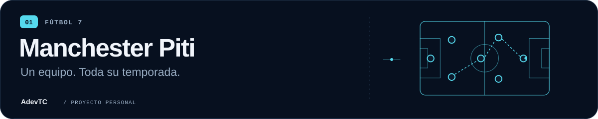
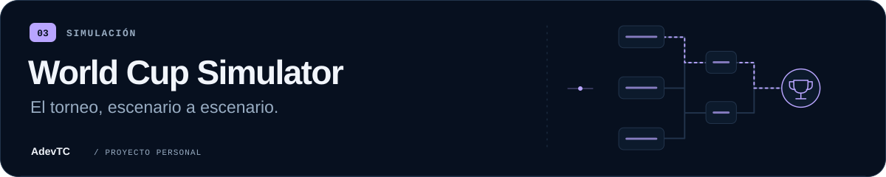
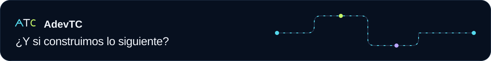

<picture>
  <source media="(max-width: 640px) and (prefers-color-scheme: dark)" srcset="./assets/hero-mobile-dark.svg" />
  <source media="(max-width: 640px) and (prefers-color-scheme: light)" srcset="./assets/hero-mobile-light.svg" />
  <source media="(prefers-color-scheme: light)" srcset="./assets/hero-light.svg" />
  
</picture>

<h1 align="center">Adrián Tomás Cerdá · AdevTC</h1>

  <strong>Responsable de BTP &amp; Integraciones en Alsea</strong> 
  Madrid, España · Ingeniería Informática en UNIR, en curso

  
  
  

  <a href="#perfil">Perfil</a> &nbsp; / &nbsp;
  <a href="#proyectos">Proyectos</a> &nbsp; / &nbsp;
  <a href="#stack">Stack</a> &nbsp; / &nbsp;
  <a href="#trayectoria">Trayectoria</a> &nbsp; / &nbsp;
  <a href="#contacto">Contacto</a>

## Perfil

Me gusta trabajar en el punto donde **los procesos de negocio, los datos y las aplicaciones** se encuentran. Conecto sistemas empresariales con SAP y desarrollo productos web a partir de ideas propias. Me interesa entender lo que ocurre por dentro y cuidar la experiencia de quien está al otro lado.

**↳ Conectar sistemas.** iFlows, Groovy, APIs y servicios con SAP CAP. He trabajado en integraciones financieras, procesos de RR. HH. e interoperabilidad sanitaria con HL7: transformar datos, seguir su recorrido y encontrar el origen de los errores.

**↳ Construir productos.** Aplicaciones con TypeScript, React y Next.js. El fútbol, las comunidades y la competición inspiran varios de mis proyectos; me gusta llevar una idea desde el modelo de datos hasta una interfaz que apetezca usar.

**↳ Seguir aprendiendo.** Compagino mi trabajo con el Grado en Ingeniería Informática en UNIR, con doble mención en Ingeniería del Software y Computación.

## Proyectos

Tres formas de llevar mis intereses al código.

### 01 · Manchester Piti

<a href="https://manchester-piti.vercel.app">
  <picture>
    <source media="(max-width: 640px) and (prefers-color-scheme: dark)" srcset="./assets/project-piti-mobile-dark.svg" />
    <source media="(max-width: 640px) and (prefers-color-scheme: light)" srcset="./assets/project-piti-mobile-light.svg" />
    <source media="(prefers-color-scheme: light)" srcset="./assets/project-piti-light.svg" />
    
  </picture>
</a>

**La vida de un equipo de fútbol 7, en una aplicación.** Resultados, estadísticas, rankings e histórico, con un vestuario privado para disponibilidad, votaciones de MVP, actas y pizarra táctica.

`React` `TypeScript` `Firebase` `Tailwind CSS` `Vite`

**[Ver aplicación ↗](https://manchester-piti.vercel.app)** &nbsp; · &nbsp; [Explorar código](https://github.com/AdevTC/Manchester-Piti)

### 02 · Fantasya

<a href="https://fantasya-app.vercel.app">
  <picture>
    <source media="(max-width: 640px) and (prefers-color-scheme: dark)" srcset="./assets/project-fantasya-mobile-dark.svg" />
    <source media="(max-width: 640px) and (prefers-color-scheme: light)" srcset="./assets/project-fantasya-mobile-light.svg" />
    <source media="(prefers-color-scheme: light)" srcset="./assets/project-fantasya-light.svg" />
    
  </picture>
</a>

**Organizar una liga y mantener conectado al grupo.** Una aplicación de ligas fantasy y comunidades privadas, con gestión de temporadas, roles y funciones sociales alrededor de la competición.

`React` `Firebase` `Tailwind CSS` `Vite`

**[Ver aplicación ↗](https://fantasya-app.vercel.app)** &nbsp; · &nbsp; [Explorar código](https://github.com/AdevTC/fantasya-app)

### 03 · World Cup 2026 Simulator

<a href="https://worldcup2026sim.vercel.app">
  <picture>
    <source media="(max-width: 640px) and (prefers-color-scheme: dark)" srcset="./assets/project-worldcup-mobile-dark.svg" />
    <source media="(max-width: 640px) and (prefers-color-scheme: light)" srcset="./assets/project-worldcup-mobile-light.svg" />
    <source media="(prefers-color-scheme: light)" srcset="./assets/project-worldcup-light.svg" />
    
  </picture>
</a>

**Un torneo, distintos escenarios.** Simulación de sorteos y fases de competición en una interfaz interactiva para explorar cómo cambia el recorrido del Mundial.

`React` `Tailwind CSS` `Vite`

**[Abrir simulador ↗](https://worldcup2026sim.vercel.app)** &nbsp; · &nbsp; [Explorar código](https://github.com/AdevTC/2026-World-Cup-Simulator)

  <a href="https://adriantomascerda.vercel.app/projects"><strong>Más proyectos en mi portfolio ↗</strong></a>
  &nbsp; · &nbsp;
  <a href="https://github.com/AdevTC?tab=repositories">Todos mis repositorios</a>

## Stack

Las herramientas cambian según el problema. Estas forman parte de mi trabajo y mis proyectos.

| Para qué | Con qué trabajo |
| :--- | :--- |
| **Integrar sistemas** | SAP BTP · Integration Suite / Cloud Integration (CPI) · Groovy · SAP PI/PO · Cloud Connector |
| **Crear servicios y modelar datos** | SAP CAP · Node.js · CDS · Java · Spring Boot |
| **Construir interfaces** | TypeScript · JavaScript · React · Next.js · Angular · Tailwind CSS |
| **Persistir información** | Firebase · MySQL · MongoDB |
| **Desarrollar y comprobar** | Git · GitHub · Docker · Postman · SAP Business Application Studio · VS Code |

<strong>Protocolos, formatos y entornos de integración</strong>

**APIs y conectividad:** OData V2/V4, REST, SOAP y SAP Cloud Connector.

**Datos y contratos:** XML, JSON, XSD, WSDL y mensajes HL7.

**Procesos y entornos:** SuccessFactors, SAP ECP, finanzas, RR. HH. e interoperabilidad sanitaria.

## Trayectoria

### Alsea · Responsable de BTP & Integraciones

**Septiembre de 2026 — actualidad**

Trabajo con SAP BTP e Integration Suite en la integración de sistemas empresariales. Mi día a día incluye el seguimiento de interfaces, el análisis de incidencias y la coordinación con los equipos implicados para entender y resolver lo que ocurre en cada proceso.

<strong>El recorrido hasta aquí · Sapas Consulting, Timestamp e Inetum</strong>

#### Sapas Consulting · Grupo Costaisa

**SAP Cloud Integrations & BTP Developer · 2025–2026**

Integraciones clínicas con **HL7 y SAP CPI**: altas, ingresos, traslados, fusión de historias y consultas externas. Desarrollo de servicios **OData V4 con SAP CAP**, modelos **CDS** y lógica de negocio con **Node.js**.

#### Timestamp

**Consultor de Integración SAP · 2025**

Integraciones de **RR. HH. y finanzas** con **SuccessFactors y SAP ECP**. Validaciones y transformaciones con Groovy, tratamiento de CSV en Base64 y generación de XML para procesos de empleados, nóminas y certificados de IRPF.

#### Inetum

**Consultor Junior de Integración SAP · 2023–2025**

Desarrollo y mantenimiento de integraciones con **SAP CPI y SAP PI/PO**, APIs REST/SOAP, contratos XSD/WSDL y conectividad entre sistemas locales y la nube mediante **SAP Cloud Connector**.

<strong>Formación, idiomas y aprendizaje acreditado</strong>

- **Grado en Ingeniería Informática · UNIR**, en curso. Doble mención en Ingeniería del Software y Computación.
- Formación en **Desarrollo de Aplicaciones Multiplataforma (DAM)** y **Desarrollo de Aplicaciones Web (DAW)** en Cesur.
- **Español nativo · Inglés B2 Cambridge · Francés básico.**

**SAP · Records of Achievement**

- [Introducing Cloud Security on SAP Business Technology Platform](https://www.credly.com/badges/b261f5e3-d1bb-44d7-afba-58b545060f42/linked_in_profile)
- [Discovering SAP Business Technology Platform](https://www.credly.com/badges/7cc1bda9-0948-4a21-9316-276e2f406994/linked_in_profile)
- [Discovering SAP Integration Suite — Managed Gateway for Spend Management and SAP Business Network](https://www.credly.com/badges/db60fc5e-07ba-4a9f-87ed-85d47ab5fdb9/linked_in_profile)

<strong>Fuera del editor</strong>

El fútbol ocupa bastante espacio en mi vida. **Manchester Piti** es mi equipo de fútbol 7 y una de las formas en las que el deporte y el desarrollo acaban encontrándose.

También me interesan el **simracing**, los videojuegos y el universo. Muchas ideas empiezan así: algo que me gusta, una pregunta y ganas de construir una respuesta.

<strong>Read in English</strong>

I'm **Adrián Tomás Cerdá**, a software developer based in Madrid, currently responsible for **SAP BTP & Integrations at Alsea**.

I connect enterprise systems using **SAP Integration Suite, Groovy, APIs, SAP CAP and Node.js**. My experience spans financial integrations, HR processes with SuccessFactors and SAP ECP, and healthcare interoperability with HL7.

Alongside that work, I build web applications with **TypeScript, React and Next.js**. My personal projects bring together football, communities and competition.

I'm studying **Computer Engineering at UNIR** and enjoy working across backend logic and user experience.

[Portfolio](https://adriantomascerda.vercel.app) · [LinkedIn](https://www.linkedin.com/in/adriantomascerda/) · [Email](mailto:adriantomascv@gmail.com)

## Contacto

Si te interesa hablar de **SAP BTP, integraciones o una idea de producto**, podemos empezar por aquí:

**[LinkedIn ↗](https://www.linkedin.com/in/adriantomascerda/)** &nbsp; · &nbsp; **[Portfolio ↗](https://adriantomascerda.vercel.app)** &nbsp; · &nbsp; **[adriantomascv@gmail.com](mailto:adriantomascv@gmail.com)**

<picture>
  <source media="(max-width: 640px) and (prefers-color-scheme: dark)" srcset="./assets/footer-mobile-dark.svg" />
  <source media="(max-width: 640px) and (prefers-color-scheme: light)" srcset="./assets/footer-mobile-light.svg" />
  <source media="(prefers-color-scheme: light)" srcset="./assets/footer-light.svg" />
  
</picture>
