<!-- AdevTC · Perfil visual. Gráficos y botones en assets/. Stats actualizadas mediante GitHub Actions. -->

<picture>
  <source media="(max-width: 640px) and (prefers-color-scheme: dark)" srcset="./assets/hero-mobile-dark.svg" />
  <source media="(max-width: 640px) and (prefers-color-scheme: light)" srcset="./assets/hero-mobile-light.svg" />
  <source media="(prefers-color-scheme: light)" srcset="./assets/hero-light.svg" />
  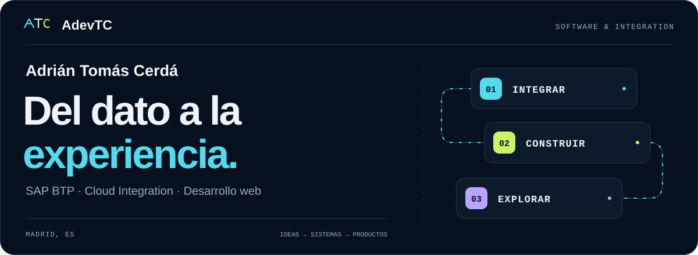
</picture>

  
  
  

  
  
  
  

  
  
  
  

## Stats

<picture>
  <source media="(max-width: 640px) and (prefers-color-scheme: dark)" srcset="./assets/metrics-mobile-dark.svg" />
  <source media="(max-width: 640px) and (prefers-color-scheme: light)" srcset="./assets/metrics-mobile-light.svg" />
  <source media="(prefers-color-scheme: light)" srcset="./assets/metrics-light.svg" />
  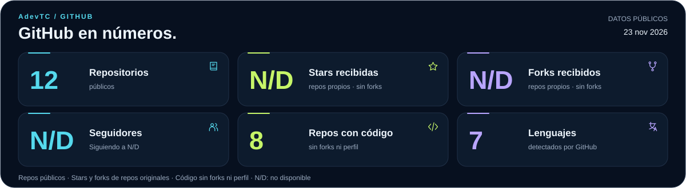
</picture>

<picture>
  <source media="(max-width: 640px) and (prefers-color-scheme: dark)" srcset="./assets/languages-mobile-dark.svg" />
  <source media="(max-width: 640px) and (prefers-color-scheme: light)" srcset="./assets/languages-mobile-light.svg" />
  <source media="(prefers-color-scheme: light)" srcset="./assets/languages-light.svg" />
  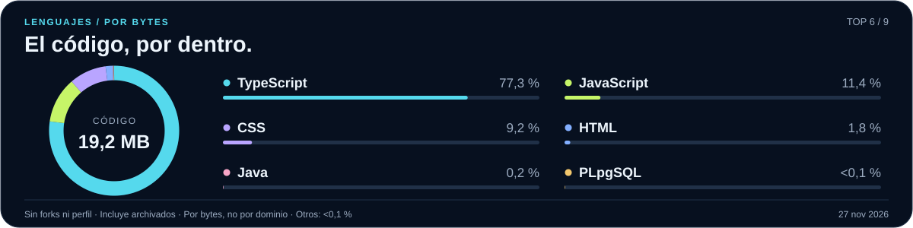
</picture>

<picture>
  <source media="(max-width: 640px) and (prefers-color-scheme: dark)" srcset="./assets/activity-mobile-dark.svg" />
  <source media="(max-width: 640px) and (prefers-color-scheme: light)" srcset="./assets/activity-mobile-light.svg" />
  <source media="(prefers-color-scheme: light)" srcset="./assets/activity-light.svg" />
  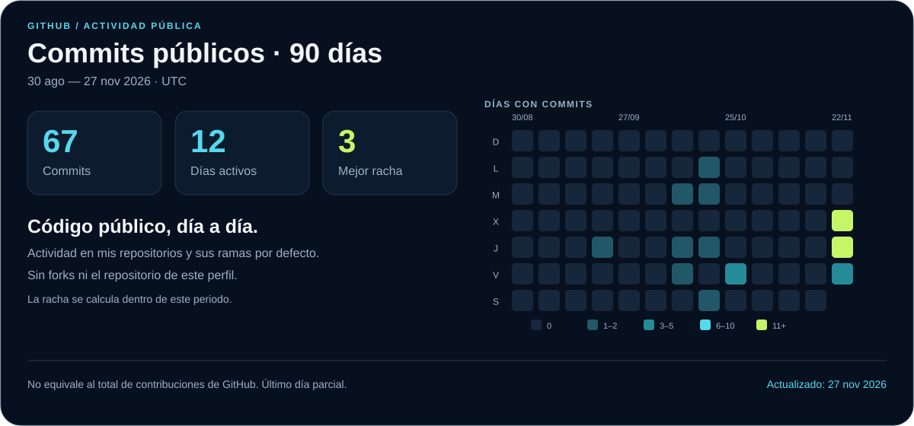
</picture>

  

Cómo se calculan las estadísticas

Datos de la API pública de GitHub, con la fecha de consulta en cada tarjeta. Los repositorios cuentan todos los públicos propios. Stars y forks suman los repositorios propios que no son forks; los lenguajes se calculan por bytes, excluyendo forks y el perfil.

La actividad recoge commits asociados a mi usuario en las ramas por defecto de mis repositorios públicos durante los últimos 90 días, excluyendo forks y este perfil. Los días activos y la mejor racha se refieren a esa ventana. No incluye PR, issues ni actividad privada.

[Datos de métricas](./assets/metrics.json) · [Datos de actividad](./assets/activity.json)

## Proyectos

<a href="https://manchester-piti.vercel.app">
<picture>
  <source media="(max-width: 640px) and (prefers-color-scheme: dark)" srcset="./assets/project-piti-mobile-dark.svg" />
  <source media="(max-width: 640px) and (prefers-color-scheme: light)" srcset="./assets/project-piti-mobile-light.svg" />
  <source media="(prefers-color-scheme: light)" srcset="./assets/project-piti-light.svg" />
  
</picture>
</a>

  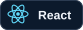
  
  
  

Fútbol 7 · Estadísticas · Vestuario privado · Pizarra táctica

  
  

 

<a href="https://fantasya-app.vercel.app">
<picture>
  <source media="(max-width: 640px) and (prefers-color-scheme: dark)" srcset="./assets/project-fantasya-mobile-dark.svg" />
  <source media="(max-width: 640px) and (prefers-color-scheme: light)" srcset="./assets/project-fantasya-mobile-light.svg" />
  <source media="(prefers-color-scheme: light)" srcset="./assets/project-fantasya-light.svg" />
  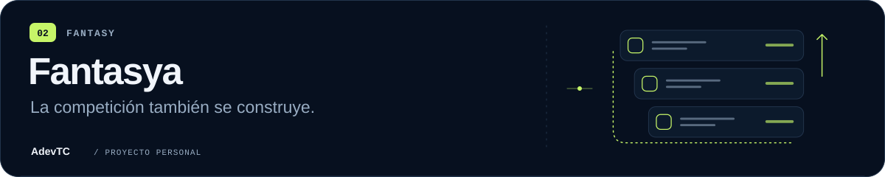
</picture>
</a>

  
  
  

Ligas fantasy · Temporadas · Comunidad · Roles

  
  

 

<a href="https://worldcup2026sim.vercel.app">
<picture>
  <source media="(max-width: 640px) and (prefers-color-scheme: dark)" srcset="./assets/project-worldcup-mobile-dark.svg" />
  <source media="(max-width: 640px) and (prefers-color-scheme: light)" srcset="./assets/project-worldcup-mobile-light.svg" />
  <source media="(prefers-color-scheme: light)" srcset="./assets/project-worldcup-light.svg" />
  
</picture>
</a>

  
  
  

Sorteos · Fases de competición · Simulación

  
  

 

  

## Stack

<h3 align="center">SAP &amp; Integración</h3>

  
  <a href="https://help.sap.com/docs/integration-suite">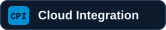</a>
  
  
  
  

<h3 align="center">Frontend</h3>

  
  
  
  
  
  

<h3 align="center">Backend &amp; Datos</h3>

  <a href="https://nodejs.org/">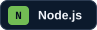</a>
  
  
  
  
  

<h3 align="center">Herramientas</h3>

  
  
  
  

<h3 align="center">APIs &amp; Formatos</h3>

  <a href="https://www.odata.org/">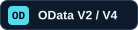</a>
  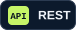
  
  
  
  

## Trayectoria

<picture>
  <source media="(max-width: 640px) and (prefers-color-scheme: dark)" srcset="./assets/ui/career-mobile-dark.svg" />
  <source media="(max-width: 640px) and (prefers-color-scheme: light)" srcset="./assets/ui/career-mobile-light.svg" />
  <source media="(prefers-color-scheme: light)" srcset="./assets/ui/career-light.svg" />
  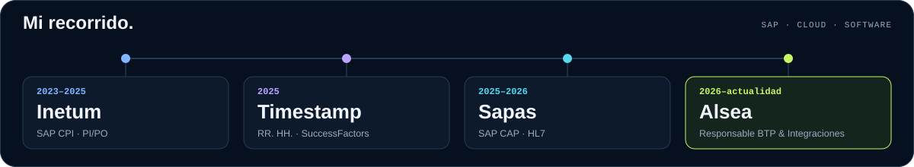
</picture>

  
  
  

<strong>Experiencia · Ver detalle</strong>

| Equipo | Especialidad |
| :--- | :--- |
| **Alsea** · sep. 2026–actualidad | Responsable de BTP e Integraciones. Seguimiento de interfaces, análisis de incidencias y coordinación técnica. |
| **Sapas Consulting / Grupo Costaisa** · 2025–2026 | HL7, SAP CPI, CAP, CDS y servicios OData V4 con Node.js. |
| **Timestamp** · 2025 | SuccessFactors, SAP ECP, Groovy e integraciones de RR. HH. y finanzas. |
| **Inetum** · 2023–2025 | SAP CPI, PI/PO, APIs REST/SOAP y Cloud Connector. |

<strong>Formación · Ver detalle</strong>

**Ingeniería Informática · UNIR, en curso.** Doble mención en Ingeniería del Software y Computación. Formación en **DAM y DAW** en Cesur.

Español nativo · Inglés B2 Cambridge · Francés básico.

<h3 align="center">SAP · Records of Achievement</h3>

  
  <a href="https://www.credly.com/badges/7cc1bda9-0948-4a21-9316-276e2f406994/linked_in_profile">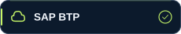</a>
  

<strong>English · About me</strong>

**Adrián Tomás Cerdá · Madrid.** Responsible for SAP BTP & Integrations at Alsea. I connect enterprise systems with SAP Integration Suite, Groovy, CAP and Node.js, and build web apps with TypeScript, React and Next.js.

Computer Engineering student at UNIR. Football, communities and competition inspire my personal projects.

## Conectamos

  
  
  

<picture>
  <source media="(max-width: 640px) and (prefers-color-scheme: dark)" srcset="./assets/footer-mobile-dark.svg" />
  <source media="(max-width: 640px) and (prefers-color-scheme: light)" srcset="./assets/footer-mobile-light.svg" />
  <source media="(prefers-color-scheme: light)" srcset="./assets/footer-light.svg" />
  
</picture>
